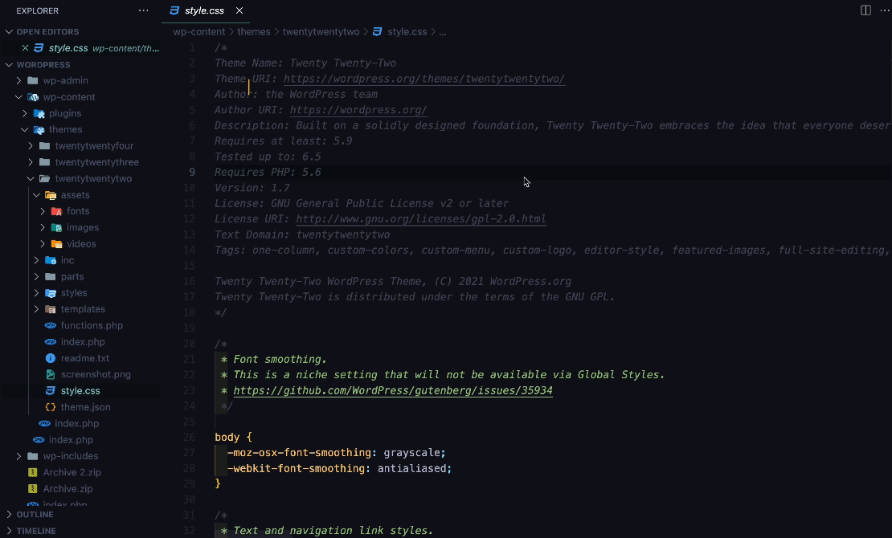
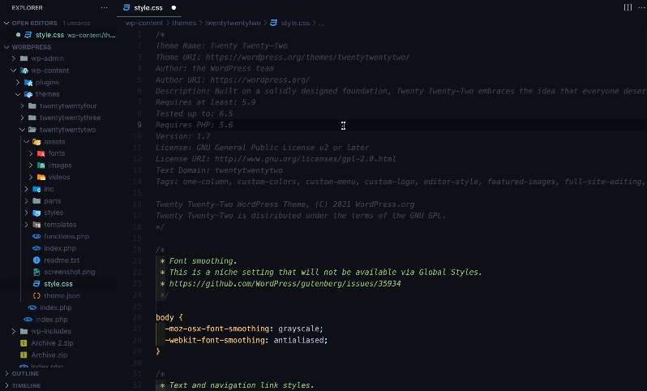

# Quick start

Minify your first CSS or JavaScript file in about a minute.

You need the extension installed. See [Install](INSTALL.md) if you have not done that yet.

## 1. Open a CSS or JavaScript file

Open any `.css` or `.js` file in VS Code. To try it with a throwaway file, create a new file, save it as `style.css`, and paste this in:

```css
/* My first stylesheet */
body {
  margin: 0px;
  font-family: Arial, sans-serif;
  background-color: #ffffff;
}

h1 {
  color: #333333;
  font-size: 2rem;
  margin-bottom: 16px;
}

.button {
  padding: 8px 16px;
  color: white;
  background-color: rgb(0, 102, 204);
}
```

## 2. Run the command

Click inside the file, then use whichever way you like best.

**With the keyboard:**

| | Windows and Linux | macOS |
| --- | --- | --- |
| Minify this File | `Ctrl+Alt+M` | `Control+Option+M` (⌃⌥M) |

**With the mouse:** right-click inside the editor and choose **Minify this File**. You can also right-click the file in the Explorer (the file list on the left).

**With the Command Palette:** press `Ctrl+Shift+P` (Windows and Linux) or `Cmd+Shift+P` (macOS), type `Minify`, and choose **Minify this File**.



## 3. See the result

The file is now a single line, the comments are gone, and it is saved. A notification in the bottom right corner tells you how much smaller it got. For the sample above it says:

```text
style.css has been successfully minified (Size reduced from 269 B to 171 B, 36% reduction)
```

The file now holds this (the numbers above were measured by running the real minifier on exactly the sample, saved with a final newline):

```css
body{background-color:#fff;margin:0;font-family:Arial,sans-serif}h1{color:#333;margin-bottom:16px;font-size:2rem}.button{color:#fff;background-color:#06c;padding:8px 16px}
```

## 4. Undo it

Minify this File replaces the content of the file and saves it. To go back:

1. Press `Ctrl+Z` (Windows and Linux) or `Cmd+Z` (macOS). Your original text comes back in the editor.
2. Press `Ctrl+S` or `Cmd+S` to save it again, because the minified version is already on disk.

> [!TIP]
> Not comfortable overwriting the original? Use the second command below, it never touches your file.

## 5. Keep the original and get a `.min` copy

The second command writes the minified result to a new file next to the original and leaves the original as it is.

| | Windows and Linux | macOS |
| --- | --- | --- |
| Minify and Save as New File | `Ctrl+Alt+N` | `Control+Option+N` (⌃⌥N) |

Or right-click and choose **Minify and Save as New File**. `style.css` becomes `style.min.css`, and by default the new file opens in the editor. The file must be saved on disk first, so a brand new unsaved file asks you to save it.



## What next

- [Commands and shortcuts](COMMANDS-AND-SHORTCUTS.md): every way to run the commands, and how to change the keys.
- [Configuration](CONFIGURATION.md): minify on save, change the `.min` name, hide the size message.
- [Examples](EXAMPLES.md): more before and after, for CSS and JavaScript.
- [Troubleshooting](TROUBLESHOOTING.md): if something does not work.
